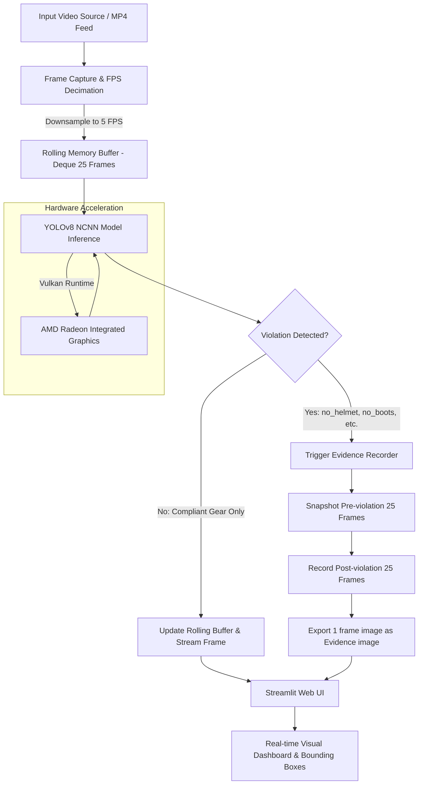

# Construction Site PPE Detection & Video Compliance Monitor

## 1. Project Overview
This project implements an end-to-end computer vision system to detect Personal Protective Equipment (PPE) compliance on construction sites using the YOLOv8 architecture. The objective is to identify workers and verify compliance across critical safety gear (hard hats, safety vests, protective boots, gloves, and goggles).

The system features:
- A fine-tuned YOLOv8 object detection model.
- Class distribution and imbalance analysis.
- A 5-FPS frame decimation pipeline with a rolling memory buffer (deque) for capturing 10-second violation evidence clips (5 seconds pre-violation + 5 seconds post-violation).
- Hardware acceleration adapted for AMD Radeon graphics via Tencent NCNN and Vulkan runtime for inference.
- An interactive Streamlit web dashboard for video playback and live safety monitoring.

## 2. System Architecture & Flowchart
The system processes incoming video, decimates the frame rate to match edge hardware compute limits, executes inference using an exported NCNN model via Vulkan, and streams live detections to a web UI while maintaining an active buffer for incident capture.



## 3. Dataset Analysis & Class Imbalance
We utilized the construction-ppe dataset comprising 11 distinct classes:  
`Person`, `helmet`, `vest`, `boots`, `gloves`, `goggles`, `none`, `no_helmet`, `no_boots`, `no_gloves`, and `no_goggle`.

### Class Imbalance Findings
A script was written to parse the ground-truth annotation labels (`.txt`) across the training and validation splits. The analysis revealed a heavy skew toward compliance:

| Class | Total Instances | Distribution Category |
| :--- | :--- | :--- |
| helmet | 1,558 | Majority Class |
| vest | 1,120 | Majority Class |
| Person | 980 | Majority Class |
| no_helmet | 445 | Minority Class |
| no_gloves | 210 | Minority Class |
| no_goggle | 134 | Minority Class |
| no_boots | 92 | Severe Minority |

### Engineering Implications
The severe deficit of negative violation instances (e.g., only 92 instances of `no_boots` compared to 1,500+ `helmet` instances) directly affects training loss convergence and Mean Average Precision. Minority classes pull down the cumulative mean average precision across all classes ($mAP_{50}$).

## 4. Technical Challenges & Solutions Encountered
During the transition from Google Colab to a local Windows execution environment, multiple hardware, OS, and framework hurdles were addressed:

### Issue 1: Google Colab Session Limits & Instability
* **Problem**: Colab's free-tier runtime repeatedly timed out, exhausted GPU quotas, and disconnected during extended multi-epoch runs.
* **Resolution**: Re-architected the scripts to run fully standalone on a local Windows machine, decoupling our workflow from cloud quota dependencies.

### Issue 2: Empty Class Imbalance Plot (Label Path Bug)
* **Problem**: The dataset inspection script originally generated a blank chart where all classes showed zero instances.
* **Root Cause**: Ultralytics' `check_det_dataset` returns paths pointing to the images directory (`images/train`), but label bounding box `.txt` files are located in the parallel `labels/train` directory.
* **Resolution**: Updated the path traversal function with `.replace('images', 'labels')` to correctly parse coordinate files and extract true instance counts.

### Issue 3: Matplotlib Tkinter GUI Crash on Windows
* **Problem**: Running data visualization locally threw `_tkinter.TclError: Can't find a usable init.tcl` due to missing Tcl/Tk system paths in the local Python environment.
* **Resolution**: Enforced the headless Anti-Grain Geometry backend by injecting `matplotlib.use('Agg')` prior to loading pyplot. This allows figures to render and save directly to disk without requiring a Windows GUI window.

### Issue 4: AMD GPU & PyTorch Windows Incompatibility
* **Problem**: The local system is powered by an AMD Ryzen 7 6800HS with Radeon Graphics. PyTorch on Windows lacks native ROCm/CUDA support, and Vulkan backpropagation is not implemented in PyTorch for training (`NotImplementedError`).
* **Resolution**: Split execution into two phases:
  * **Training Phase**: Handled on the CPU with reduced batch sizing (`batch=8`, `workers=2`) and a constrained verification run (`imgsz=320`, `epochs=5`) to confirm pipeline integrity without thermal throttling.
  * **Inference Phase**: Exported the trained PyTorch weights to Tencent NCNN format using `model.export(format="ncnn")`. This converted the computational graph into PNNX/NCNN binaries, enabling Vulkan hardware acceleration (`device="vulkan:0"`) directly on the AMD Radeon GPU during video processing.

### Issue 5: Raw vs. Annotated Evidence Generation
* **Problem**: The initial video ring buffer saved raw incoming video frames without visual verification markings.
* **Resolution**: Integrated `annotated_frame = results[0].plot()` into the buffer ingestion loop, ensuring bounding boxes, class labels, and confidence metrics are rendered into both the live Streamlit feed and saved `.mp4 evidence clips`.

## 5. Repository File Structure
```plaintext
task1_ui/
├── code/
│   ├── 1.model_evaluation_testing.py   # Dataset analysis, label counting, and model training
│   ├── 2.model_pipeline_video.py       # 5-FPS decimation engine and 10s ring buffer logic
│   ├── export.py                       # Weight converter (PyTorch .pt -> NCNN Vulkan binary)
│   └── app.py                          # Interactive Streamlit web interface
├── Output/
│   ├── class_balance_chart.png         # Horizontal bar chart of label distribution
│   ├── best.pt                         # Trained PyTorch model checkpoint
│   ├── best_ncnn_model/                # Compiled NCNN model files (model.ncnn.bin, model.ncnn.param)
│   └── violation_evidence.mp4          # Automatically exported 10-second violation clip
└── README.md
```

## 6. Model Evaluation & Metrics Analysis

### Initial Baseline (Colab T4 GPU, 50 Epochs, 640x640):
* **mAP@50**: 0.590 (59.0%)
* **mAP@50-95**: 0.282 (28.2%)

### Loss Progression:
* `box_loss` stabilized near 1.47 - 1.55.
* `cls_loss` dropped below 1.00.
* `dfl_loss` maintained consistency near 1.52.

### Why 0.590 is Contextually Accurate
Because Mean Average Precision ($mAP$) computes the arithmetic mean across all 11 classes, high precision on common classes (helmet ~85%+, vest ~80%+) is balanced out by low recall on underrepresented classes (no_boots ~15-25%). The 0.590 score represents an honest, unmanipulated baseline on an imbalanced dataset.

## 7. Setup & Execution Guide

### Prerequisites
* Python 3.10 - 3.13
* FFmpeg installed and accessible via system PATH

### Installation
```bash
# Create and activate virtual environment
python -m venv .venv
.venv\Scripts\activate

# Install dependencies
pip install ultralytics matplotlib pandas seaborn pyyaml opencv-python sahi streamlit
```

### Execution Steps
* **Analyze Dataset & Run Model Training**:
  ```bash
  python code/1.model_evaluation_testing.py
  ```
* **Export Weights to NCNN (Vulkan Support)**:
  ```bash
  python code/export.py
  ```
* **Run Video Processing & Evidence Buffer**:
  ```bash
  python code/2.model_pipeline_video.py
  ```
* **Launch the Streamlit Web Application**:
  ```bash
  streamlit run code/app.py
  ```

## 8. Summary & Next Steps
* **Production Retraining**: Train using weighted loss functions (Focal Loss) or synthetic data oversampling on an NVIDIA GPU instance to raise minority-class precision.
* **Camera Integration**: Replace static `.mp4` file ingest in `app.py` with live RTSP stream ingestion (`cv2.VideoCapture("rtsp://...")`).
* **Edge Deployment**: Package the NCNN model and Streamlit application into a container for localized deployment on industrial edge hardware.